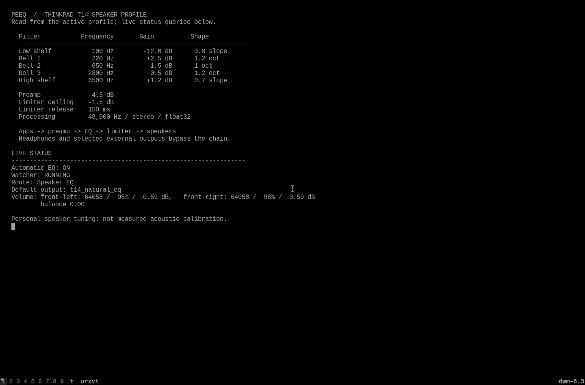

# peeq

My speaker EQ and output routing setup for a ThinkPad T14 Gen 2 Intel running Void Linux and PulseAudio.



## Signal path

```text
Applications → −4.5 dB preamp → five-band EQ → peak limiter → built-in speakers
Headphones / selected USB, Bluetooth or HDMI output → direct output
```

The controller runs only the speaker-specific chain when the built-in speaker route is selected. The virtual sink names retain the `t14_` prefix from my daily setup.

## Settings

48 kHz, stereo, floating-point processing. The profile is in [`profiles/t14.json`](profiles/t14.json); [view the profile screenshot](assets/profile.png).

| Filter | Frequency | Gain | Shape |
| --- | --- | --- | --- |
| Low shelf | 100 Hz | −12 dB | slope 0.8 |
| Bell 1 | 220 Hz | +2.5 dB | 1.2 octaves |
| Bell 2 | 650 Hz | −1.5 dB | 1.0 octave |
| Bell 3 | 2.8 kHz | −0.5 dB | 1.2 octaves |
| High shelf | 6.5 kHz | +1.2 dB | slope 0.7 |

Preamp: **−4.5 dB**. Limiter: **0 dB input gain, −1.5 dB ceiling, 150 ms release**. Bell widths are in octaves, not Q; shelf controls are slopes. The profile arrays use the SWH plugin port order.

This is personal preference tuning for these laptop speakers, not a microphone-measured correction. The bass cut reduces low-frequency drive; the preamp leaves room for the boosts. The sample-peak limiter is not a true-peak limiter or a speaker thermal/excursion model. Downstream volume changes can raise the level after limiting.

## Improvements

- Uses jack availability to bypass speaker EQ when headphones are connected, even if the active port has not updated yet.
- Respects a selected external output instead of forcing it through the laptop correction.
- Checks actual filter connections and repairs misrouted links.
- Moves application streams while leaving filter streams alone.
- Rolls back newly loaded filters if chain creation fails.
- Serializes route changes and prevents duplicate watchers with file locks.
- Watches PulseAudio events, with a five-second reconciliation fallback and reconnection after server restarts.

## Use

Requires Linux, Python 3, PulseAudio with JSON-capable `pactl` and `module-ladspa-sink`, and the [SWH LADSPA plugins](https://github.com/swh/ladspa). Native PipeWire is not tested.

On Void, the plugins are packaged as `swh-plugins`. The controller expects these files in `~/.local/lib/ladspa/`:

```text
amp_1181.so
triple_para_1204.so
fast_lookahead_limiter_1913.so
```

Copy or symlink those three files from your distribution's LADSPA directory. Plugin binaries are not included here.

Place `bin/speaker-eq` in `~/.local/bin/` and copy `profiles/t14.json` to `~/.config/speaker-eq/profile.json`, creating the directories if necessary. Before enabling it, set `master` to the built-in output shown by `pactl list short sinks`; the included ALSA name is specific to my machine. Read `pactl list sinks` to check that the card exposes speaker/headphone port types. Unknown ports bypass EQ.

```sh
speaker-eq status   # inspect the selected route
speaker-eq auto     # enable speaker EQ and start the watcher
speaker-eq off      # bypass EQ; keep watching output changes
```

`on` is an alias for `auto`. Add `speaker-eq watch &` to your X session startup if you want it after login. Do not run the controller with sudo. `settings.json` stores the enabled state; runtime locks and status live under `~/.local/state/speaker-eq/`.

The script also recognizes its original `BEGIN/END T14 SPEAKER EQ` block in `~/.config/pulse/default.pa` and removes that block when toggled, so old static filters do not compete with the watcher. Back up that file if migrating from the older setup. To stop using this configuration, run `speaker-eq off` and remove its startup entry; the idle watcher is released at logout.

## Checks

```sh
python3 -m unittest discover -s tests -v
```

All 11 routing/module-layout tests pass. Routing tests use synthetic sink data and do not connect to PulseAudio. On 23 October 2026, the live default output, all three filter links and their control values were checked against this profile. Physical hotplug and acoustic response were not remeasured for this publication. The screenshot shows the saved profile and read-only live status; the controller has no EQ GUI.

## Credits

DSP: Steve Harris's [SWH plugins](https://github.com/swh/ladspa), specifically [triplePara](https://github.com/swh/ladspa/blob/master/triple_para_1204.xml), [fastLookaheadLimiter](https://github.com/swh/ladspa/blob/master/fast_lookahead_limiter_1913.xml) and [amp](https://github.com/swh/ladspa/blob/master/amp_1181.xml). PulseAudio provides the LADSPA hosting and output graph. Plugin code and binaries retain their upstream licenses and are not bundled.

Related: [Void configuration](https://github.com/merthium/void-config) · [dwm](https://github.com/merthium/dwm).
